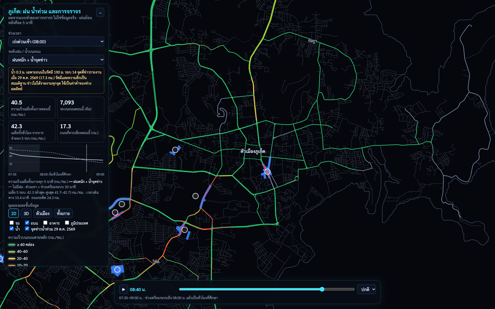
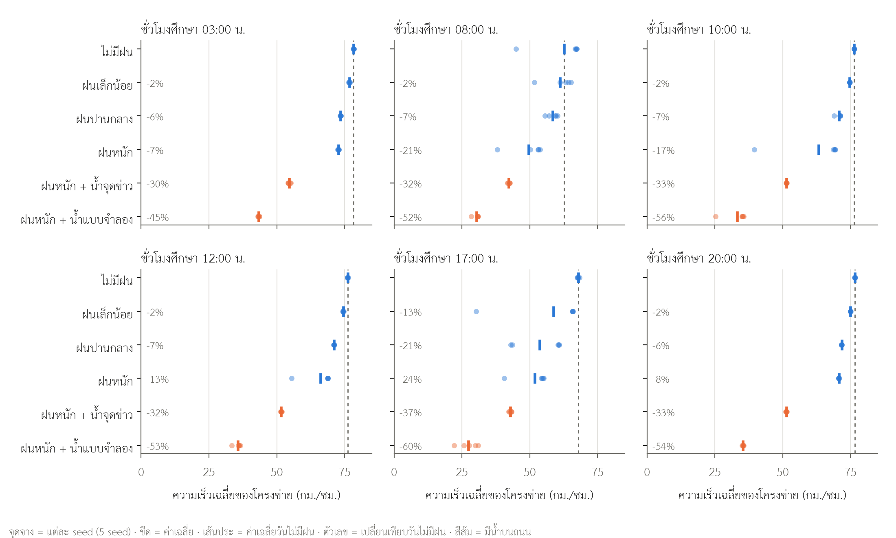

# Phuket Native: rain, flooding and traffic in Phuket

An island-wide traffic simulation of Phuket, Thailand, that estimates how rain and standing water on roads slow traffic at different times of day. It is built from open data and values from published studies.

**Status (Nov 2026):** research draft. A Thai manuscript is in [`manuscript/`](manuscript/). The code and method notes for every step are in this repository. The input data and model outputs are not, so the scripts cannot be rerun from a fresh clone without downloading the data first (see [Running it](#running-it)).

**Open the viewer: https://ariyaluesawat.github.io/phuket-traffic-flood-sim/** (simulation results, not real traffic data; best on a computer)



## What it does

| Part | How |
|---|---|
| Road network | OpenStreetMap → SUMO: 44,963 edges, 4,439 km, the whole island |
| Traffic demand | `routeSampler.py` fitted to 36 count stations (71 station–directions) from the Department of Highways and the Department of Rural Roads; 6 study hours (03, 08, 10, 12, 17, 20) |
| Traffic model | SUMO 1.28, mesoscopic; 20% of vehicles reroute every 300 s |
| Rain | Speed and capacity factors from HCM 2010 and SHRP 2-L08 (via FHWA 2013) for light, moderate and heavy rain |
| Flooding | 2D local inertial flood model (Bates et al., 2010) on FABDEM 30 m, SCS curve number losses, ERA5 rain for 26–29 Oct 2026 |
| Coupling | TraCI lowers each road's speed limit every 5 minutes by water depth (Pregnolato et al., 2017). **Roads are never closed.** Drivers who see standing water ahead reroute |
| Scenarios | 6 hours × 6 scenarios × 5 seeds = 180 runs |
| Viewer | deck.gl 2D/3D playback in 5-minute steps |

## Main results

Network mean speed, change from a dry day (5 seeds):

| | Light rain | Moderate rain | Heavy rain | Heavy rain + water at reported places (17 km) | Heavy rain + modelled water (126 km) |
|---|---|---|---|---|---|
| Off-peak hours | −2% | −6 to −7% | −7 to −17% | −30 to −33% | −45 to −56% |
| Peak hours | −2 to −14% | −7 to −21% | −21 to −24% | −33 to −37% | −52 to −60% |

- Rain alone has a small effect when roads are not busy. At peak hours some runs tip into growing congestion, so results vary a lot between seeds.
- Water on roads matters far more than rain alone. Every flood run had growing congestion, even at 03:00.



## Limitations: read before using the numbers

1. **The flood model failed its check.** At 14 places reported flooded in the news on 29 Oct 2026, the model had ≥ 0.1 m of water at 21% of them, close to 18% for random roads. It also drains more slowly than the provincial disaster office reported. The flood results are therefore given as a range: water only at the reported places (low) and modelled water (high).
2. **The results depend strongly on assumptions** (sensitivity analysis, [`docs/step10-method.md`](docs/step10-method.md)). The largest is the speed in water ≥ 0.3 m, set to 2.1 km/h. At 10 km/h the effect of water at the reported places on speed almost disappears (−20.6% → −0.7%).
3. **Calibration is not independent validation.** The same count stations were used to build demand. Hourly profiles are assumed, and there is no measured speed data.
4. Rain effects come from US freeways. Motorcycles are modelled as small cars.

**Use the results for comparing scenarios and deciding what data to collect next, not for forecasting delays or naming flooded roads.** Every assumption is listed in the manuscript (Table 9) and in the method notes.

## Repository layout

| Path | Contents |
|---|---|
| [`WORKFLOW.md`](WORKFLOW.md) | The 11 steps and their status (Thai) |
| [`docs/`](docs/) | Method notes for each step (`step4-method.md` … `step10-method.md`), result tables, data inventory, references, figures |
| [`manuscript/`](manuscript/) | Thai manuscript draft (Markdown and PDF) |
| [`scripts/`](scripts/) | Every step as a script; each file starts with its usage and inputs |
| [`config/`](config/) | Rain factors and the assumed hourly profile |
| [`web/app/index.html`](web/app/index.html) | The viewer (data files are generated by `scripts/export_web.py`) |
| `forms/`, `scripts/*survey*`, `scripts/*jamovi*` | A questionnaire for viewer users and analysis-practice scripts. **No real survey has been run; synthetic practice data is not included and is not used in the research.** |

## Running it

Requirements: Python 3.12, `osmium`, and Google Chrome (for figures of the viewer only).

```bash
python3.12 -m venv .venv && .venv/bin/pip install -r requirements.txt
.venv/bin/python scripts/check_env.py
```

Data to download into `data/raw/` (not in the repository; sources and dates in [`docs/data-inventory.md`](docs/data-inventory.md) and [`docs/references.md`](docs/references.md)):
OpenStreetMap Thailand extract (Geofabrik), Copernicus DEM GLO-30, FABDEM V1-2, ESA WorldCover 2021, ERA5 hourly rain (Open-Meteo), and the traffic count datasets from datagov.mot.go.th.

Then, in order:

```bash
.venv/bin/python scripts/build_network.py                 # step 3
.venv/bin/python scripts/make_counts.py                   # step 4
.venv/bin/python scripts/build_demand.py
.venv/bin/python scripts/run_baseline.py
.venv/bin/python scripts/rain_effects.py                  # step 5
.venv/bin/python scripts/prepare_flood_inputs.py          # step 6
.venv/bin/python scripts/prepare_flood_inputs.py fabdem
.venv/bin/python scripts/flood_model.py --hours 78 --drainage 80 --dem dem_fabdem_conditioned.tif --drain-roads
.venv/bin/python scripts/road_flood_depth.py              # step 7
scripts/step8.sh start                                    # long runs (steps 7-10), stop/pause/resume any time
.venv/bin/python scripts/run_scenarios.py summary         # step 8 tables
.venv/bin/python scripts/run_playback.py                  # step 9
.venv/bin/python scripts/export_web.py
cd web/app && ../../.venv/bin/python -m http.server 8765  # open http://127.0.0.1:8765
.venv/bin/python scripts/make_figures.py                  # manuscript figures
```

The 180 scenario runs take roughly a day on a 10-core laptop. Each script's docstring lists its options; the method notes explain each choice.

## Data and licences

- Road and building data © OpenStreetMap contributors, ODbL.
- FABDEM (Hawker et al., 2022), Copernicus DEM, ESA WorldCover and ERA5 under their own licences; see `docs/references.md`.
- Downloaded papers are kept out of the repository for copyright reasons.

## Author

Ariya Luesawat, Artificial Intelligence and System Engineering, College of Computing, Prince of Songkla University, Phuket Campus. [GitHub](https://github.com/AriyaLuesawat)
