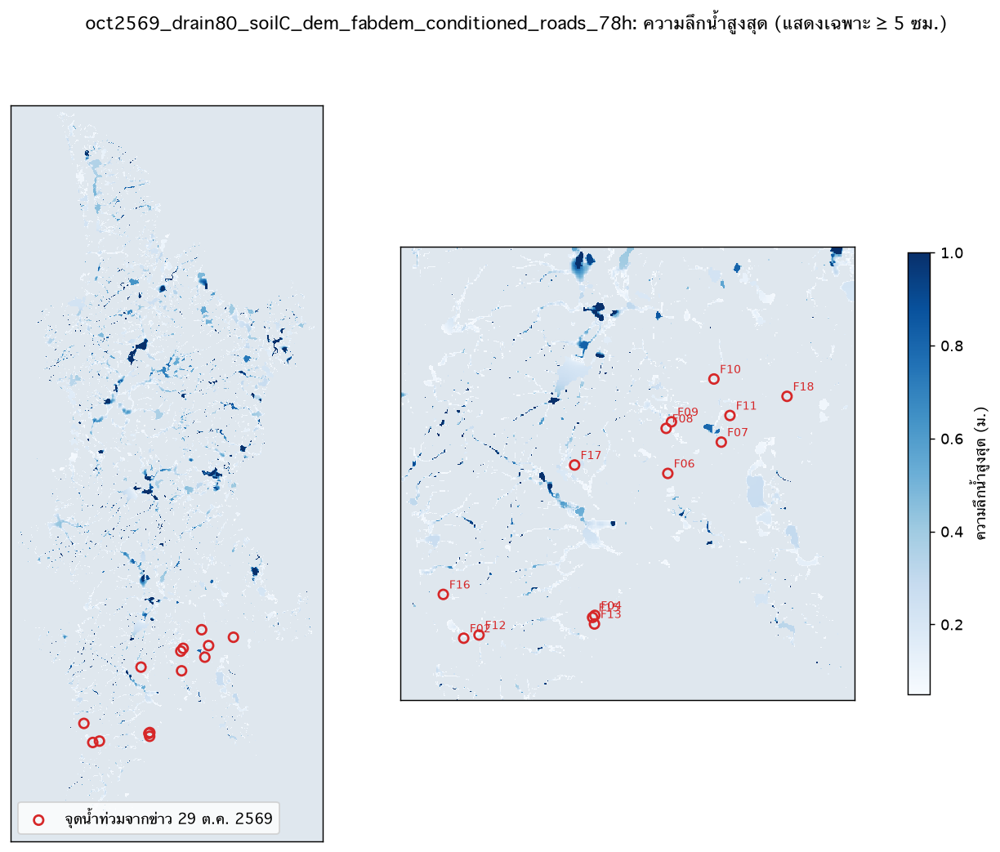
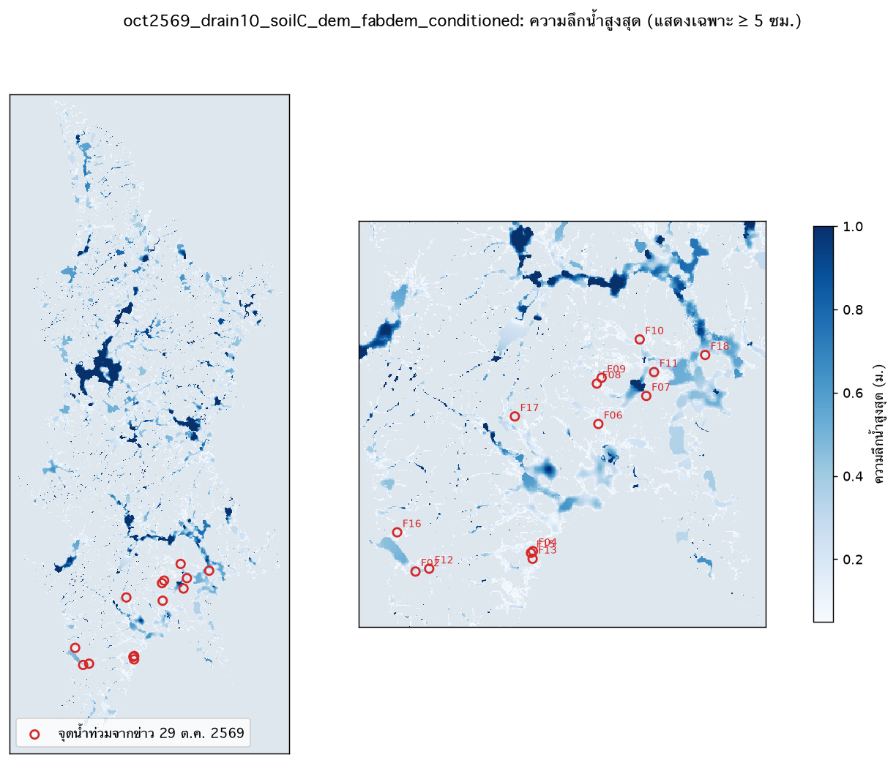

# ตรวจผลแบบจำลองน้ำท่วมกับจุดที่ข่าวรายงาน (ขั้นที่ 6)

คะแนนของแต่ละจุด = ความลึกสูงสุดที่แบบจำลองให้ในรัศมี 60 ม. (เฉพาะเซลล์ถนน, พิกัดจากชื่อสถานที่ คลาดเคลื่อนได้) เทียบกับถนนในพื้นที่อาคารสุ่ม 2,000 จุด ใช้ตรวจเชิงคุณภาพเท่านั้น

## oct2569_drain80_soilC_dem_fabdem_conditioned_roads_78h

ฝนรวม 278 มม. ใน 78 ชม. · ระบาย 80 มม./ชม. · กลุ่มดิน C · พื้นที่น้ำลึกสูงสุด > 0.1 ม. 55.5 ตร.กม., > 0.3 ม. 21.3 ตร.กม.

| เกณฑ์ | จุดจากข่าวที่แบบจำลองท่วม | ถนนสุ่มที่แบบจำลองท่วม |
|---|---|---|
| ≥ 0.1 ม. | 3/14 (21%) | 18% |
| ≥ 0.3 ม. | 0/14 (0%) | 4% |

| จุด | สถานที่ | ข่าวรายงาน | ความลึกสูงสุดในแบบจำลอง (ม.) |
|---|---|---|---|
| F02 | แยกไฟแดงโคกโตนด | รถเล็กผ่านไม่ได้ | 0.12 |
| F04 | หน้าโลตัสฉลอง | ระดับเข่า | 0.00 |
| F06 | หมู่บ้านแคลิฟอร์เนีย ซอย 9 | ท่วม ไม่ระบุความลึก | 0.00 |
| F07 | แยกท่าแครง ดาวรุ่ง | ท่วม ไม่ระบุความลึก | 0.00 |
| F08 | หน้าโรงพยาบาลดีบุก | ท่วม ไม่ระบุความลึก | 0.05 |
| F09 | หน้าคิงพาวเวอร์ | ท่วม 1 ช่องจราจร | 0.00 |
| F10 | หน้าโรงเรียนภูเก็ตไทยหัว | ท่วม ไม่ระบุความลึก | 0.11 |
| F11 | สวนหลวงนาคา (สวนหลวง ร.9) | ระดับน้ำสูง | 0.00 |
| F12 | หน้าสถานีดับเพลิงกะตะ | ท่วม ไม่ระบุความลึก | 0.12 |
| F13 | ซุปเปอร์ชีปใสยวน ถึงปากซอยสามัคคี 4 | ท่วม ไม่ระบุความลึก | 0.00 |
| F15 | ห้าแยกฉลอง | ท่วม ไม่ระบุความลึก | 0.00 |
| F16 | หน้าห้างซุปเปอร์ชีป สาขากะรน | ท่วม ไม่ระบุความลึก | 0.05 |
| F17 | หน้าตลาดนากก | ท่วม ไม่ระบุความลึก | 0.00 |
| F18 | วงเวียนหอนาฬิกา (น้ำจากคลองบางใหญ่ล้น) | ได้รับผลกระทบจากคลองบางใหญ่ล้น | 0.00 |

## oct2569_drain10_soilC_dem_fabdem_conditioned

ฝนรวม 274 มม. ใน 72 ชม. · ระบาย 10 มม./ชม. · กลุ่มดิน C · พื้นที่น้ำลึกสูงสุด > 0.1 ม. 94.4 ตร.กม., > 0.3 ม. 50.9 ตร.กม.

| เกณฑ์ | จุดจากข่าวที่แบบจำลองท่วม | ถนนสุ่มที่แบบจำลองท่วม |
|---|---|---|
| ≥ 0.1 ม. | 6/14 (43%) | 51% |
| ≥ 0.3 ม. | 1/14 (7%) | 24% |

| จุด | สถานที่ | ข่าวรายงาน | ความลึกสูงสุดในแบบจำลอง (ม.) |
|---|---|---|---|
| F02 | แยกไฟแดงโคกโตนด | รถเล็กผ่านไม่ได้ | 0.24 |
| F04 | หน้าโลตัสฉลอง | ระดับเข่า | 0.05 |
| F06 | หมู่บ้านแคลิฟอร์เนีย ซอย 9 | ท่วม ไม่ระบุความลึก | 0.15 |
| F07 | แยกท่าแครง ดาวรุ่ง | ท่วม ไม่ระบุความลึก | 0.01 |
| F08 | หน้าโรงพยาบาลดีบุก | ท่วม ไม่ระบุความลึก | 0.09 |
| F09 | หน้าคิงพาวเวอร์ | ท่วม 1 ช่องจราจร | 0.00 |
| F10 | หน้าโรงเรียนภูเก็ตไทยหัว | ท่วม ไม่ระบุความลึก | 0.31 |
| F11 | สวนหลวงนาคา (สวนหลวง ร.9) | ระดับน้ำสูง | 0.00 |
| F12 | หน้าสถานีดับเพลิงกะตะ | ท่วม ไม่ระบุความลึก | 0.23 |
| F13 | ซุปเปอร์ชีปใสยวน ถึงปากซอยสามัคคี 4 | ท่วม ไม่ระบุความลึก | 0.03 |
| F15 | ห้าแยกฉลอง | ท่วม ไม่ระบุความลึก | 0.03 |
| F16 | หน้าห้างซุปเปอร์ชีป สาขากะรน | ท่วม ไม่ระบุความลึก | 0.13 |
| F17 | หน้าตลาดนากก | ท่วม ไม่ระบุความลึก | 0.01 |
| F18 | วงเวียนหอนาฬิกา (น้ำจากคลองบางใหญ่ล้น) | ได้รับผลกระทบจากคลองบางใหญ่ล้น | 0.11 |

