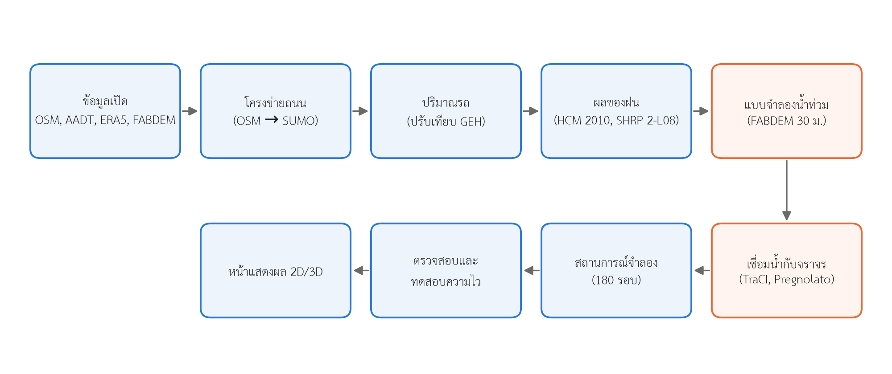
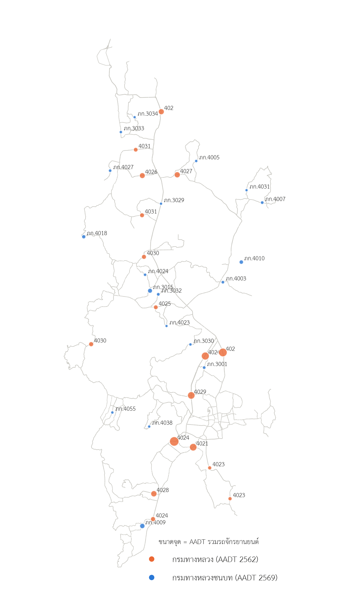
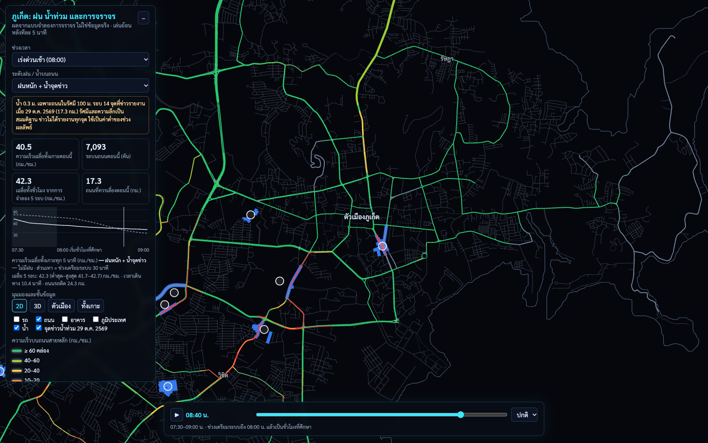
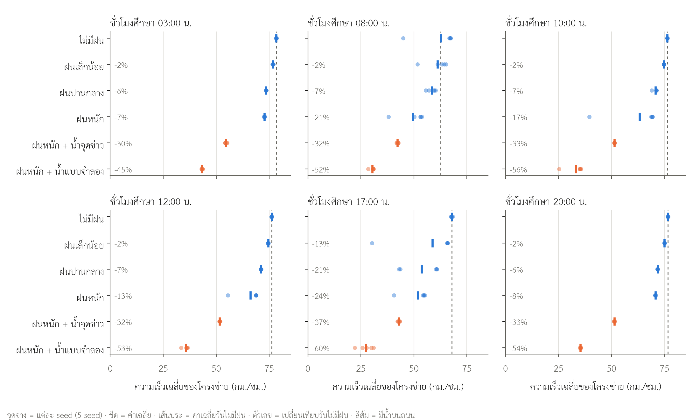
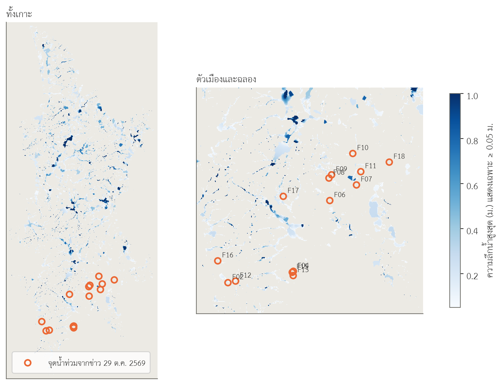
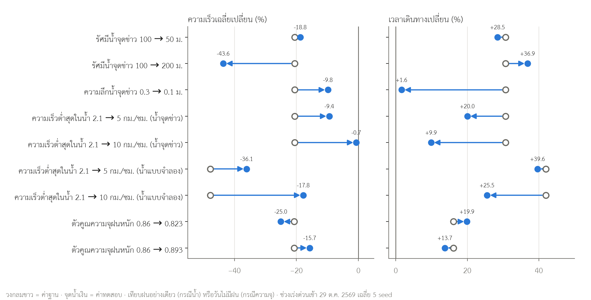

# แบบจำลองผลของฝนและน้ำท่วมขังต่อการจราจรทั้งเกาะภูเก็ต ด้วย SUMO แบบ mesoscopic และแบบจำลองน้ำท่วมจาก DEM

**นายอริยะ ลือสวัสดิ์**

สาขาวิชาวิศวกรรมปัญญาประดิษฐ์และระบบอัจฉริยะ วิทยาลัยการคอมพิวเตอร์ มหาวิทยาลัยสงขลานครินทร์ วิทยาเขตภูเก็ต

**ร่างฉบับที่ 1** · 10 พฤศจิกายน 2569

## บทคัดย่อ

ภูเก็ตมีฝนตกหนักและน้ำท่วมขังบนถนนเป็นประจำ แต่ยังไม่มีเครื่องมือที่ประเมินผลของฝนและน้ำขังต่อการจราจรทั้งเกาะ งานนี้สร้างแบบจำลองจราจร SUMO แบบ mesoscopic บนโครงข่ายถนน OpenStreetMap ทั้งเกาะ (44,963 ช่วงถนน ยาว 4,439 กม.) ปรับเทียบปริมาณรถกับจุดนับของกรมทางหลวงและกรมทางหลวงชนบท 71 จุด-ทิศทาง (GEH < 5 ได้ 89–100% ของจุดนับในทุกช่วงเวลา) ใส่ผลของฝนเป็นตัวคูณความเร็วและความจุจาก Highway Capacity Manual 2010 และ SHRP 2-L08 และเชื่อมกับแบบจำลองน้ำท่วม 2 มิติแบบ local inertial บน FABDEM 30 ม. ผ่าน TraCI โดยลดความเร็วตามความลึกน้ำด้วยฟังก์ชันของ Pregnolato et al. (2017) แทนการปิดถนน จำลอง 6 ช่วงเวลา × 6 สถานการณ์ × 5 seed (180 รอบ) โดยใช้เหตุการณ์ฝนตกหนัก 26–29 ตุลาคม 2569 ผลพบว่าฝนอย่างเดียวลดความเร็วเฉลี่ยของโครงข่าย 2–8% ในช่วงที่รถไม่หนาแน่น แต่ในช่วงเร่งด่วน ฝนหนักลดความเร็ว 21–24% เพราะบางรอบเกิดรถติดสะสม เมื่อเพิ่มน้ำบนถนน ความเร็วลด 30–37% (น้ำเฉพาะถนนรอบจุดที่ข่าวรายงาน 17.3 กม.) ถึง 45–60% (น้ำจากแบบจำลอง 126.3 กม.) อย่างไรก็ตาม แบบจำลองน้ำท่วมไม่ผ่านการตรวจกับจุดน้ำท่วมจากข่าว (จุดข่าวมีน้ำ ≥ 0.1 ม. 21% เทียบถนนสุ่ม 18%) และการวิเคราะห์ความไวพบว่าขนาดของผลขึ้นกับค่าสมมติฐานมาก โดยเฉพาะความเร็วต่ำสุดบนถนนน้ำลึก ถ้าเปลี่ยนจาก 2.1 เป็น 10 กม./ชม. ผลของน้ำจุดข่าวต่อความเร็วลดจาก −20.6% เหลือ −0.7% ผลของงานนี้จึงใช้ได้ในเชิงเปรียบเทียบสถานการณ์และชี้ข้อมูลที่ต้องเก็บเพิ่ม ไม่ใช่การพยากรณ์ความล่าช้าจริง

**คำสำคัญ:** การจำลองการจราจร, SUMO, น้ำท่วมขังในเมือง, ฝน, ภูเก็ต, depth–disruption function

## 1. บทนำ

ฝนลดความเร็วและความจุของถนน และน้ำที่ขังบนผิวถนนทำให้รถต้องลดความเร็วหรือเลี่ยงเส้นทาง (Federal Highway Administration [FHWA], 2013; Pregnolato et al., 2017) ในประเทศไทย Takano et al. (2023) วิเคราะห์ข้อมูลรถ probe ของกรุงเทพฯ ปี 2018–2020 พบว่าฝน 10 มม./ชม. ลดความเร็วเดินทางในพื้นที่เฉลี่ยราว 10.3% และถ้ามีฝนสะสม 10 มม. ใน 5 ชั่วโมงก่อนหน้าจะลดราว 20.7% โดยผลสูงกว่าในช่วงเร่งด่วนและพื้นที่ต่ำ

ภูเก็ตเป็นเกาะที่มีถนนสายหลักไม่กี่สายเชื่อมพื้นที่ต่าง ๆ และมีฝนตกหนักในฤดูมรสุม ช่วงวันที่ 26–29 ตุลาคม 2569 ข้อมูล ERA5 ให้ฝนรวม 278 มม. ใน 78 ชั่วโมง และข่าววันที่ 29 ตุลาคม 2569 รายงานถนนที่น้ำท่วมหลายจุดทั่วเกาะ (กรุงเทพธุรกิจ, 2569; ไทยโพสต์, 2569) น้ำท่วมลักษณะนี้มักขังไม่กี่ชั่วโมง ปภ.ภูเก็ตรายงานว่าเวลา 10:00 น. ของวันเดียวกัน น้ำในหลายพื้นที่กลับเป็นปกติ (Spacebar, 2569) จึงไม่มีการปิดถนน แต่รถช้าลงและต้องเลี่ยงเส้นทาง

ภูเก็ตยังขาดข้อมูลหลายอย่างที่ต้องใช้ประเมินผลนี้โดยตรง ไม่มีปริมาณรถรายชั่วโมงสาธารณะ ไม่มีข้อมูลความเร็วรถในวันฝนตก และไม่มีข้อมูลท่อระบายน้ำ งานนี้จึงสร้างแบบจำลองจากข้อมูลเปิดและค่าจากงานวิจัย โดยมีวัตถุประสงค์ 3 ข้อ

1. สร้างแบบจำลองจราจรทั้งเกาะภูเก็ตที่ปรับเทียบปริมาณรถกับจุดนับที่มีอยู่ และจำลองผลของฝนแต่ละระดับในช่วงเวลาต่าง ๆ ของวัน
2. เชื่อมแบบจำลองน้ำท่วมจากข้อมูลความสูงพื้นที่เข้ากับแบบจำลองจราจร โดยลดความเร็วตามความลึกน้ำแทนการปิดถนน
3. ตรวจความสมเหตุสมผลของผล และระบุว่าผลไวต่อค่าสมมติฐานใดมากที่สุด

งานนี้ยังทำหน้าแสดงผล 2D/3D บนเว็บสำหรับดูผลของแต่ละสถานการณ์ด้วย (หัวข้อ 3.8)

## 2. การทบทวนวรรณกรรม

### 2.1 ผลของฝนต่อความเร็วและความจุของถนน

Highway Capacity Manual 2010 (Transportation Research Board, 2010, อ้างใน FHWA, 2013) ให้ค่าการลดความจุของทางพิเศษตามความเข้มฝน 3 ระดับ (เล็กน้อย ≤ 0.10 นิ้ว/ชม., ปานกลาง ≤ 0.25 นิ้ว/ชม., หนัก > 0.25 นิ้ว/ชม.) เฉลี่ย 2.01%, 7.24% และ 14.13% ส่วนโครงการ SHRP 2-L08 ให้ค่าการลดความเร็วอิสระตามความเร็วอิสระของถนนและระดับฝน (FHWA, 2013, ภาคผนวก A) ทั้งสองแหล่งได้จากทางพิเศษในสหรัฐอเมริกา

สำหรับประเทศไทย Takano et al. (2023) วัดผลรวมของฝนต่อความเร็วเดินทางในกรุงเทพฯ ซึ่งรวมทั้งการลดความเร็วของผู้ขับขี่ การติดขัดที่เพิ่มขึ้น และการเปลี่ยนรูปแบบการเดินทาง ค่าของ Takano et al. จึงเทียบได้กับผลรวมของแบบจำลอง แต่ใช้เป็นค่าป้อนเข้าโดยตรงไม่ได้

### 2.2 ผลของน้ำบนถนนต่อการเดินทาง

Pregnolato et al. (2017) ชี้ว่าวิธีประเมินผลของน้ำท่วมต่อการจราจรที่มีอยู่มักถือว่าถนนเปิดเต็มที่หรือปิดทั้งเส้น ซึ่งไม่ตรงกับที่สังเกตได้ จึงสร้างความสัมพันธ์ระหว่างความลึกน้ำบนถนนกับความเร็วรถ (depth–disruption function) โดย fit เส้นโค้งกับการวิเคราะห์วิดีโอร่วมกับข้อมูลเชิงปริมาณจากงานวิจัยและเอกสารด้านความปลอดภัย (R² = 0.95) ฟังก์ชันใช้กับความลึก 0–300 มม. และบทความระบุว่าที่ 300 มม. รถยนต์นั่งเริ่มลอย งานนี้ใช้ฟังก์ชันดังกล่าวแทนการกำหนดให้ถนนที่มีน้ำปิดทั้งเส้น

### 2.3 การจำลองน้ำท่วมจากข้อมูลความสูงพื้นที่

Bates et al. (2010) เสนอสมการน้ำตื้น 2 มิติแบบ local inertial ที่คำนวณได้เร็วพอสำหรับพื้นที่ขนาดใหญ่ การซึมลงดินประมาณได้ด้วยวิธี SCS curve number (United States Department of Agriculture [USDA], 1986) ข้อมูลความสูงพื้นที่ระดับโลกขนาด 30 ม. เช่น Copernicus DEM (European Space Agency, 2022) เป็นแบบจำลองพื้นผิว (DSM) ที่รวมความสูงของอาคารและต้นไม้ FABDEM (Hawker et al., 2022) ลบอาคารและต้นไม้ออกด้วยการเรียนรู้ของเครื่อง จึงเหมาะกว่าสำหรับการไหลของน้ำ แอ่งเทียมใน DEM จัดการได้ด้วยวิธีเติมแอ่ง (Barnes et al., 2014; Soille, 2004)

### 2.4 การจำลองการจราจรด้วย SUMO

SUMO เป็นโปรแกรมจำลองการจราจรแบบเปิด (Álvarez López et al., 2018) มีทั้งแบบ microscopic (รถทีละคัน) และ mesoscopic ที่แทนถนนแต่ละช่วงด้วยแถวคอยตามแนวของ Eissfeldt (2004) แบบ mesoscopic เร็วกว่ามากและเหมาะกับโครงข่ายขนาดใหญ่ แต่มีงานล่าสุดที่วิเคราะห์ข้อจำกัดของแบบ mesoscopic ใน SUMO (Ni et al., 2026) TraCI ทำให้เปลี่ยนความเร็วสูงสุดของถนนระหว่างการจำลองได้ จึงเชื่อมกับผลของแบบจำลองน้ำท่วมได้ เกณฑ์ที่ใช้กันทั่วไปในการปรับเทียบปริมาณรถคือ GEH < 5 ในมากกว่า 85% ของจุดนับ (Department for Transport, 2024)

### 2.5 ช่องว่างของงานวิจัย

[ต้องค้นเพิ่มก่อนส่ง: งานที่เชื่อมแบบจำลองน้ำท่วมกับแบบจำลองจราจร งานจราจรหรือน้ำท่วมของภูเก็ต และงานที่ใช้ SUMO ในประเทศไทย การค้นในขั้นที่ 1 ยังไม่พบงานที่จำลองผลของฝนและน้ำท่วมต่อการจราจรทั้งเกาะภูเก็ต แต่การค้นยังไม่เป็นระบบ จึงยังเขียนว่า "ไม่มีงาน" ไม่ได้]

## 3. วิธีการ

### 3.1 ภาพรวม

งานนี้แบ่งเป็น 4 ส่วน (1) โครงข่ายถนนและปริมาณรถ (2) ผลของฝน (3) แบบจำลองน้ำท่วม และ (4) การเชื่อมน้ำท่วมกับจราจร ทั้งหมดรันบนเครื่องเดียว และหยุดแล้วรันต่อได้ ค่าที่ไม่มีแหล่งอ้างอิงระบุว่าเป็น**สมมติฐาน**ในข้อความและในตารางที่ 9 (รูปที่ 1)

**รูปที่ 1** ขั้นตอนของงาน กรอบสีส้มคือส่วนที่เกี่ยวกับน้ำท่วม

### 3.2 ข้อมูล

**ตารางที่ 1** ข้อมูลที่ใช้

| ข้อมูล | แหล่ง | หมายเหตุ |
|---|---|---|
| ถนนและอาคาร | OpenStreetMap contributors (2026) ไฟล์ Geofabrik ณ 1 พ.ย. 2569 | จำนวนช่องและความเร็วจำกัดไม่ครบทุกเส้น |
| ปริมาณรถรายปี ทางหลวงแผ่นดิน | กรมทางหลวง (2563) ปี 2562 | ใช้ปีก่อนโควิด-19 |
| ปริมาณรถรายปี ทางหลวงชนบท | กรมทางหลวงชนบท (2569) ปี 2569 | 19 สายในภูเก็ต |
| ฝนรายชั่วโมง | ERA5 (Hersbach et al., 2020) ผ่าน Open-Meteo (n.d.) ปี 2000–2026 | กริดราว 25 กม. ความเข้มสูงสุดต่ำกว่าสถานีวัด |
| เกณฑ์ฝนรายวัน | กรมอุตุนิยมวิทยา อ้างใน สำนักงานสถิติแห่งชาติ (2567) | ใช้ตั้งชื่อสถานการณ์ |
| ความสูงพื้นที่ 30 ม. | FABDEM V1-2 (Hawker et al., 2022) | เทียบกับ Copernicus DEM GLO-30 |
| การใช้ที่ดิน 10 ม. | ESA WorldCover 2021 v200 (Zanaga et al., 2022) | |
| จุดน้ำท่วม 29 ต.ค. 2569 | ข่าว (กรุงเทพธุรกิจ, 2569; ไทยโพสต์, 2569; Thai PBS, [ปี]) | 14 จุดที่หาพิกัดได้จากชื่อสถานที่ ไม่มีความลึกที่วัดได้ |

ข้อมูลที่ไม่มีและต้องใช้ค่าประมาณแทน ได้แก่ ปริมาณรถรายชั่วโมงของภูเก็ต ปริมาณรถบนถนนในเขตเมืองที่ไม่มีจุดนับ ความเร็วรถจริง และท่อระบายน้ำและสถานีสูบน้ำ

### 3.3 โครงข่ายถนน

แปลงถนน OSM เป็นโครงข่าย SUMO ด้วย netconvert ได้ 44,963 ช่วงถนน (edge) ยาวรวม 4,439 กม. ทางแยก 20,246 จุด และสัญญาณไฟ 74 จุด (จากแท็ก `highway=traffic_signals`) กลุ่มที่เชื่อมถึงกันทุกทิศที่ใหญ่ที่สุดครอบคลุม 99.4% ของ edge ถนนที่ OSM ไม่ระบุจำนวนช่องหรือความเร็วจำกัดใช้ค่าเริ่มต้นตามประเภทถนนของ SUMO เช่น ถนน residential มีข้อมูลจำนวนช่องเพียง 2% ก่อนแปลงได้แก้แท็กทางลอดบนทางหลวง 402 จำนวน 10 ways ที่ทำให้ทางหลวงขาดที่เกาะแก้ว

### 3.4 ปริมาณรถและการปรับเทียบ

**จุดนับ:** 36 จุด (กรมทางหลวง 17 จุด กรมทางหลวงชนบท 19 สาย, รูปที่ 2) แยกทิศทางได้ 71 จุด-ทิศทาง ค่าเป้าหมายรายชั่วโมง = AADT ต่อทิศทาง × สัดส่วนรายชั่วโมง ซึ่งเป็น**สมมติฐาน** เพราะไม่มีข้อมูลรายชั่วโมงของภูเก็ต (ชั่วโมงสูงสุด 8% ของ AADT ทั้งช่วงเช้าและเย็น)

**ความต้องการเดินทาง:** `routeSampler.py` ของ SUMO เลือกเส้นทางจากชุดเส้นทางตัวเลือกให้จำนวนรถผ่านจุดนับใกล้ค่าเป้าหมาย แยก 4 กลุ่มรถ (รถยนต์ รถโดยสาร รถบรรทุก รถจักรยานยนต์) ชุดเส้นทางตัวเลือกประกอบด้วยเส้นทางสุ่มทั่วเกาะ 40,000 เส้น และเส้นทางที่ผ่านจุดนับจุดละ 60 เส้น จำกัดความยาวไม่เกิน 10 กม. เพราะ routeSampler นับว่ารถผ่านทุกจุดนับบนเส้นทางในชั่วโมงที่ออกเดินทาง แต่รถที่วิ่งไกลถึงจุดนับท้าย ๆ หลังหมดชั่วโมง การจำกัดความยาวร่วมกับเส้นทางผ่านจุดนับเพิ่ม GEH < 5 ของช่วงเย็นจาก 61% เป็น 96%

**ระดับของแบบจำลอง:** แบบ microscopic ติดขัดทั้งเกาะในช่วงเย็นทุกแบบที่ทดสอบ (รถค้างตอนจบราว 22,000–36,000 คัน) และเวลารอกระจายทั่วโครงข่าย จึงใช้แบบ mesoscopic และปิดการควบคุมทางแยกของ meso ซึ่งทำให้ GEH ดีที่สุดในการทดสอบ (61% เทียบ 51–58%)

**การหาเส้นทางใหม่:** ให้รถ 20% มีอุปกรณ์หาเส้นทางใหม่ของ SUMO ตามเวลาเดินทางปัจจุบันทุก 300 วินาที ค่านี้เลือกจากการทดสอบ 0%, 10%, 20% และ 100% ในวันไม่มีฝน (ตารางที่ 2) และเป็น**สมมติฐาน** ไม่มีข้อมูลสัดส่วนนี้ของภูเก็ต

**รูปที่ 2** จุดนับปริมาณรถบนถนนสายหลักของภูเก็ต ขนาดจุดตาม AADT รวมรถจักรยานยนต์

**ตารางที่ 2** GEH < 5 ช่วงเร่งด่วน วันไม่มีฝน ตามสัดส่วนรถที่หาเส้นทางใหม่ (seed 42)

| สัดส่วน | เช้า | เย็น | teleport เช้า / เย็น |
|---|---|---|---|
| 0% | 92% | 96% | 99 / 16 |
| 10% | 96% | 92% | 0 / 691 |
| **20% (ใช้)** | **96%** | **96%** | **0 / 0** |
| 100% | 23% | 24% | 0 / 0 |

ที่ 100% รถราว 1 ใน 3 ย้ายออกจากถนนสายหลักที่มีจุดนับ จึงไม่ผ่านเกณฑ์

**ช่วงเวลา:** 6 ช่วง ชั่วโมงศึกษาเริ่ม 03:00, 08:00, 10:00, 12:00, 17:00 และ 20:00 น. อุ่นเครื่อง 30 นาทีก่อนชั่วโมงศึกษา

**เกณฑ์:** GEH = √(2(M − C)² / (M + C)) เมื่อ M คือปริมาณรถจำลองและ C คือค่าเป้าหมายต่อชั่วโมง ผ่านเมื่อ GEH < 5 ในมากกว่า 85% ของจุดนับ (Department for Transport, 2024, ตาราง 2)

### 3.5 ผลของฝน

ใช้เกณฑ์ฝนรายชั่วโมงของ HCM 2010 (เล็กน้อย 0.1–2.54, ปานกลาง 2.54–6.35, หนัก ≥ 6.35 มม./ชม.) ขอบล่าง 0.1 มม./ชม. เป็นค่าที่เลือกให้ตรงกับเกณฑ์วันฝนตกของกรมอุตุนิยมวิทยา

**ตารางที่ 3** ตัวคูณความจุและความเร็วอิสระ

| ระดับฝน | ตัวคูณความจุ (ช่วง) | ตัวคูณความเร็วอิสระ |
|---|---|---|
| เล็กน้อย | 0.98 (0.966–0.988) | 0.98 |
| ปานกลาง | 0.93 (0.899–0.943) | 0.94 |
| หนัก | 0.86 (0.823–0.893) | 0.93 |

ที่มา: ความจุจาก HCM 2010 (TRB, 2010, อ้างใน FHWA, 2013, ตาราง 33) ความเร็วระดับปานกลางและหนักจาก SHRP 2-L08 ที่ความเร็วอิสระ 65 ไมล์/ชม. (FHWA, 2013, ตาราง 34) ฝนเล็กน้อยเป็นค่าประมาณในตัวอย่างของ FHWA (2013)

ใส่ความเร็วโดยคูณ speedFactor ของรถทุกคัน และใส่ความจุโดยหาร headway ของแบบจำลอง meso ด้วยตัวคูณความจุ ฝนตกเท่ากันทั้งเกาะ (ERA5 ช่องกริดเดียวครอบทั้งเกาะ) **สมมติฐาน:** ความต้องการเดินทางในวันฝนตกเท่ากับวันไม่มีฝน

### 3.6 แบบจำลองน้ำท่วม

**กริดและข้อมูลเข้า:** กริด 30 ม. ระบบพิกัด UTM 47N เฉพาะเกาะภูเก็ต (บก 523 ตร.กม.) ความสูงจาก FABDEM ที่ปรับแอ่ง ฝน ERA5 รายชั่วโมงเท่ากันทั้งเกาะ ช่วง 26 ต.ค. 07:00 ถึง 29 ต.ค. 12:00 (78 ชม., 278 มม.)

**สมการ:**
- การไหลใช้ local inertial approximation (Bates et al., 2010) ช่วงเวลาตามเงื่อนไข CFL (α = 0.7) ปริมาตรน้ำคลาดเคลื่อนน้อยกว่า 10⁻¹⁰ %
- การซึมใช้ SCS curve number (USDA, 1986) ตามประเภทการใช้ที่ดินของ WorldCover กลุ่มดิน C ทั้งเกาะ (**สมมติฐาน** เพราะไม่มีแผนที่ดิน)
- ค่า Manning's n ใช้ค่ากลางของช่วงในคู่มือ HEC-RAS 2D (U.S. Army Corps of Engineers [USACE], n.d.)
- ทะเลเป็นขอบเขตความลึก 0 ไม่รวมน้ำขึ้นน้ำลง

**การปรับ DEM:** หาระดับล้นของทุกแอ่ง (Soille, 2004; Barnes et al., 2014) แล้วเติมแอ่งที่ลึกน้อยกว่า 1 ม. หรือมีต้นไม้หรือแหล่งน้ำเกิน 50% ของพื้นที่แอ่ง (**สมมติฐาน**) FABDEM มีแอ่ง 2,849 แอ่ง เติม 2,736 คงไว้ 113 แอ่ง (17.2 ตร.กม.)

**การระบายน้ำ:** ไม่มีข้อมูลท่อระบายน้ำ จึงให้เซลล์อาคารและเซลล์ถนนเสียน้ำด้วยอัตราคงที่ 80 มม./ชม. ค่านี้**เป็นค่าปรับเทียบ ไม่มีแหล่งอ้างอิงทางวิศวกรรม** เลือกจาก 20, 40 และ 80 มม./ชม. เพราะทำให้น้ำบนถนนลดเร็วใกล้รายงานของ ปภ. มากที่สุด (ตารางที่ 4)

**ตารางที่ 4** ความยาวถนน (กม.) ที่น้ำ ≥ 0.1 ม. / ≥ 0.3 ม. ตามอัตราระบาย

| ระบาย (มม./ชม.) | 28 ต.ค. 09:00 | 29 ต.ค. 06:00 | 29 ต.ค. 08:00 | 29 ต.ค. 10:00 | 29 ต.ค. 12:00 |
|---|---|---|---|---|---|
| 20 | 1,003 / 436 | 846 / 355 | 766 / 328 | 717 / 304 | 685 / 293 |
| 40 | 727 / 308 | 596 / 225 | 541 / 210 | 491 / 198 | 460 / 195 |
| **80 (ใช้)** | 515 / 184 | 387 / 144 | 330 / 126 | 289 / 117 | 259 / 111 |

### 3.7 การเชื่อมน้ำท่วมกับจราจร

**ความลึกบนถนน:** ความลึกของแต่ละ edge คือค่ามากสุดของเซลล์ใต้เส้นกึ่งกลางถนน (สุ่มทุก 5 ม.) สะพานและอุโมงค์ตามแท็ก OSM 91 edge ให้ความลึก 0 และไม่นับเซลล์ถนนในระยะ 30 ม. จากลำน้ำ OSM (**สมมติฐาน:** ถนนข้ามเหนือท่อลอด)

**ความเร็วตามความลึก:** ทุก 300 วินาที TraCI ตั้งความเร็วสูงสุดของ edge เป็น min(ความเร็วเดิม, v(w)) โดย v(w) = 0.0009w² − 0.5529w + 86.9448 (w เป็นมม., v เป็นกม./ชม.) (Pregnolato et al., 2017, สมการ 4) ที่ w ≥ 300 มม. ซึ่งอยู่นอกช่วงที่ฟังก์ชัน fit ไว้ คงความเร็วที่ v(300) = 2.1 กม./ชม. (**สมมติฐาน** แทนการปิดถนน) ถนนน้ำ ≥ 0.3 ม. นับเป็น "ถนนที่ควรเลี่ยง"

**การเลี่ยงน้ำขัง (สมมติฐาน):** รถที่เส้นทางข้างหน้ามีถนนน้ำ ≥ 0.3 ม. ได้อุปกรณ์หาเส้นทางใหม่เพิ่ม แทนผู้ขับขี่ที่รู้ว่ามีน้ำขังจากข่าวหรือเห็นเอง

**น้ำบนถนนสองแบบ:** เพราะแบบจำลองน้ำท่วมไม่ผ่านการตรวจ (หัวข้อ 4.4) จึงใช้น้ำสองแบบเพื่อให้ได้ช่วงของผล

1. **น้ำแบบจำลอง (ค่าสูง):** ความลึกจากหัวข้อ 3.6 มีถนนที่ควรเลี่ยงเฉลี่ย 126.3 กม. ในชั่วโมงศึกษา
2. **น้ำจุดข่าว (ค่าต่ำ):** น้ำ 0.3 ม. บนถนนที่รถยนต์ใช้ได้ในรัศมี 100 ม. จาก 14 จุดที่ข่าวรายงาน รวม 216 edge ยาว 17.3 กม. น้ำเต็มที่ 07:00–09:00 น. ขึ้นจาก 0 ที่ 06:00 และลดเป็น 0 ที่ 10:00 รัศมี ความลึก และเวลาเป็น**สมมติฐาน**

### 3.8 สถานการณ์จำลอง ตัวชี้วัด และหน้าแสดงผล

**สถานการณ์:** 6 ช่วงเวลา × 6 สถานการณ์ × 5 seed = 180 รอบ ได้แก่ ไม่มีฝน ฝนเล็กน้อย ฝนปานกลาง ฝนหนัก ฝนหนัก + น้ำจุดข่าว และฝนหนัก + น้ำแบบจำลอง **สมมติฐาน:** สถานการณ์น้ำใช้สภาพน้ำของ 29 ต.ค. 08:00–09:00 กับทุกช่วงเวลา ความต่างระหว่างช่วงเวลาจึงมาจากปริมาณรถอย่างเดียว

**ตัวชี้วัด:**
- ความเร็วเฉลี่ยของโครงข่าย ถ่วงด้วยเวลาที่รถอยู่บนแต่ละถนน
- เวลาเดินทางเฉลี่ยของเที่ยวที่จบ
- ความยาวถนนรถติด (ความเร็วเฉลี่ย < 10 กม./ชม.)
- ความยาวถนนที่ควรเลี่ยง
- รถค้างตอนจบ และ teleport
- จำนวนรอบที่รถติดสะสม (ความเร็ว < 80% ของค่าเฉลี่ยวันไม่มีฝนของช่วงเวลาเดียวกัน)

เกณฑ์ 10 กม./ชม. และ 80% เป็นนิยามของงานนี้

**หน้าแสดงผล (รูปที่ 6):** หน้าเว็บ deck.gl เล่นผล seed 1 ของทุกสถานการณ์ทีละ 5 นาที แสดงสีถนนตามความเร็ว จุดแสงตามจำนวนรถเฉลี่ยบนถนน น้ำบนถนน และอาคาร 3 มิติ ข้อความถึงผู้ใช้ของถนนน้ำ ≥ 0.3 ม. คือ "ควรเลี่ยง อาจมีน้ำท่วมขัง รอระบาย" ไม่ใช่ "ถนนปิด" รอบที่รันใหม่เพื่อเก็บผลราย 5 นาทีให้ความเร็วเฉลี่ยตรงกับรอบเดิมทุกรอบ

**รูปที่ 6** หน้าแสดงผล มุมมอง 2D ช่วงเร่งด่วนเช้า สถานการณ์ฝนหนัก + น้ำจุดข่าว เวลา 08:40 น. (seed 1) สีถนนสายหลักตามความเร็ว ซอยเป็นสีเทา เส้นสีน้ำเงินหนาคือถนนน้ำ ≥ 0.3 ม. วงกลมขาวคือจุดข่าว

### 3.9 การตรวจความสมเหตุสมผล

1. เทียบปริมาณรถกับค่าเป้าหมายของจุดนับ (GEH)
2. เทียบน้ำในแบบจำลองกับ 14 จุดที่ข่าวรายงาน คะแนนของแต่ละจุดคือความลึกสูงสุดของเซลล์ถนนในรัศมี 60 ม. เทียบกับคะแนนแบบเดียวกันของถนนในพื้นที่อาคารสุ่ม 2,000 จุด ถ้าแบบจำลองชี้ตำแหน่งได้ จุดข่าวต้องมีน้ำบ่อยกว่าถนนสุ่ม และเทียบเวลาที่น้ำลดกับรายงานของ ปภ.
3. ตรวจแผนที่น้ำท่วมจากดาวเทียมของ GISTDA ช่วงเหตุการณ์
4. วิเคราะห์ความไวช่วงเร่งด่วนเช้า 29 ต.ค. เปลี่ยนค่าสมมติฐานทีละค่า ค่าละ 5 seed (ตารางที่ 8)

## 4. ผล

### 4.1 การปรับเทียบปริมาณรถ

วันไม่มีฝนที่รถ 20% หาเส้นทางใหม่ผ่านเกณฑ์ทุกช่วงเวลาและทุก seed (ตารางที่ 5) ต่ำสุด 89% ที่ช่วงเร่งด่วนเช้า seed 1 ซึ่งเป็นรอบที่เกิดรถติดสะสม

**ตารางที่ 5** GEH < 5 ของ 71 จุดนับ-ทิศทาง วันไม่มีฝน

| ช่วงเวลา | GEH < 5 (seed 1–5) |
|---|---|
| 03:00 | 100% ทุก seed |
| 08:00 | 89, 96, 94, 96, 96% |
| 10:00 | 99% ทุก seed |
| 12:00 | 99% ทุก seed |
| 17:00 | 93, 92, 94, 93, 94% |
| 20:00 | 99% ทุก seed |

### 4.2 ผลของฝน

ในช่วงที่รถไม่หนาแน่น (03:00, 10:00, 12:00, 20:00) ฝนเล็กน้อยและปานกลางลดความเร็วเฉลี่ย 2.0–7.3% ทุก seed ใกล้กัน ซึ่งใกล้กับตัวคูณความเร็วที่ใส่ (ตารางที่ 6) ในช่วงเร่งด่วนและฝนหนัก บาง seed เกิดรถติดสะสม (0–2 จาก 5 รอบ) ค่าเฉลี่ยจึงลดมากกว่าค่าที่ใส่ และช่วงระหว่าง seed กว้าง เช่น เร่งด่วนเย็นฝนเล็กน้อย 30.3–65.9 กม./ชม. เร่งด่วนเช้าวันไม่มีฝนก็มี 1 seed ที่ติดสะสม (44.9 กม./ชม.)

### 4.3 ผลของฝนหนักและน้ำบนถนน

**รูปที่ 4** ความเร็วเฉลี่ยของโครงข่ายแต่ละสถานการณ์และช่วงเวลา จุดจางคือแต่ละ seed ขีดคือค่าเฉลี่ย 5 seed

**ตารางที่ 6** ความเร็วเฉลี่ย 5 seed (กม./ชม.) และการเปลี่ยนเทียบวันไม่มีฝน

| ชั่วโมงศึกษา | ไม่มีฝน | ฝนเล็กน้อย | ฝนปานกลาง | ฝนหนัก | ฝนหนัก + น้ำจุดข่าว | ฝนหนัก + น้ำแบบจำลอง |
|---|---|---|---|---|---|---|
| 03:00 | 78.3 | 76.7 (−2.0%) | 73.5 (−6.1%) | 72.7 (−7.2%) | 54.5 (−30.4%) | 43.3 (−44.7%) |
| 08:00 | 62.6 | 61.2 (−2.4%) | 58.4 (−6.8%) | 49.7 (−20.7%) | 42.3 (−32.5%) | 30.4 (−51.5%) |
| 10:00 | 76.3 | 74.7 (−2.2%) | 70.7 (−7.3%) | 63.2 (−17.2%) | 51.4 (−32.7%) | 33.2 (−56.4%) |
| 12:00 | 76.1 | 74.5 (−2.2%) | 71.1 (−6.6%) | 66.1 (−13.1%) | 51.6 (−32.2%) | 35.6 (−53.2%) |
| 17:00 | 67.8 | 58.7 (−13.5%) | 53.7 (−20.8%) | 51.9 (−23.5%) | 42.9 (−36.8%) | 27.3 (−59.7%) |
| 20:00 | 76.6 | 75.0 (−2.1%) | 71.7 (−6.4%) | 70.7 (−7.8%) | 51.3 (−33.0%) | 35.3 (−53.9%) |

**ตารางที่ 7** ตัวชี้วัดอื่นของสถานการณ์น้ำ (ช่วงของ 6 ช่วงเวลา)

| ตัวชี้วัด | ฝนหนัก + น้ำจุดข่าว | ฝนหนัก + น้ำแบบจำลอง |
|---|---|---|
| ถนนที่ควรเลี่ยง (กม.) | 17.3 | 126.3 |
| เวลาเดินทางเปลี่ยน | +41.4% ถึง +45.9% | +57.3% ถึง +61.4% |
| ถนนรถติด < 10 กม./ชม. (กม.) | 6.4–24.3 | 46.2–105.4 |
| รอบที่รถติดสะสม | 5/5 ทุกช่วงเวลา | 5/5 ทุกช่วงเวลา |

น้ำบนถนนทำให้รถติดสะสมทุก seed ทุกช่วงเวลา รวมทั้งช่วง 03:00 ที่รถน้อย (ความเร็วลด 30–45%, teleport 0) เพราะรถที่ต้องผ่านถนนน้ำลึกวิ่งได้ 2.1 กม./ชม. และบางคันมีต้นทางหรือปลายทางบนถนนนั้นจึงเลี่ยงไม่ได้ ผลของน้ำจึงขึ้นกับปริมาณน้ำบนถนนมากกว่าปริมาณรถ ผลของน้ำจุดข่าวคงที่ระหว่าง seed (เช่น 08:00 อยู่ที่ 41.7–42.7 กม./ชม.)

ช่วงเร่งด่วนเช้า 29 ต.ค. 2569 ที่ใช้ฝนจริงของชั่วโมงนั้น (0.5 มม./ชม., ระดับเล็กน้อย) น้ำจุดข่าวลดความเร็วจาก 61.2 เป็น 48.6 กม./ชม. (−20.6%) และเพิ่มเวลาเดินทาง 30.7% ส่วนน้ำแบบจำลองลดเป็น 31.9 กม./ชม. (−47.8%) และเพิ่มเวลาเดินทาง 41.9% ถ้าไม่มีการเลี่ยงน้ำขัง (มีแต่รถ 20% ที่หาเส้นทางใหม่) ความเร็วลด 63.8% และถ้ารถทุกคันหาเส้นทางใหม่ ความเร็วลด 19.5% แต่กรณีหลังไม่ผ่าน GEH

### 4.4 การตรวจพื้นที่น้ำท่วม

- **จุดข่าว (รูปที่ 3):** แบบจำลองให้น้ำ ≥ 0.1 ม. ที่จุดข่าว 3 จาก 14 จุด (21%) เทียบกับถนนสุ่ม 18% และน้ำ ≥ 0.3 ม. 0 จาก 14 จุด เทียบกับถนนสุ่ม 4% แบบจำลองจึงชี้ตำแหน่งถนนที่ท่วมได้ไม่ดีกว่าการสุ่ม แบบเดิมที่ระบาย 10 มม./ชม. ให้ 6/14 (43%) เทียบถนนสุ่ม 51% ซึ่งไม่ผ่านเช่นกัน
- **ดาวเทียม:** แผนที่น้ำท่วมของ GISTDA (`flood_7days`, `flood_30days`, `stac_flood1day`) ไม่มีพื้นที่น้ำท่วมในภูเก็ตช่วงเหตุการณ์ จึงตรวจพื้นที่ไม่ได้
- **เวลาที่น้ำลด:** เวลา 10:00 น. ของ 29 ต.ค. แบบจำลองยังมีถนนน้ำ ≥ 0.3 ม. 117 กม. ขณะที่ ปภ. รายงานว่าน้ำกลับเป็นปกติ น้ำที่ค้างอยู่ในเซลล์ต้นไม้ 52% แหล่งน้ำ 19% ป่าชายเลน 12% และเซลล์อาคารเพียง 1%

**รูปที่ 3** ความลึกน้ำสูงสุดของแบบจำลองช่วง 26–29 ต.ค. 2569 (แสดงเฉพาะ ≥ 0.05 ม.) และจุดน้ำท่วมจากข่าว 14 จุด

### 4.5 ความไวต่อค่าสมมติฐาน

**ตารางที่ 8** ผลเมื่อเปลี่ยนค่าสมมติฐานทีละค่า ช่วงเร่งด่วนเช้า 5 seed (การเปลี่ยนเทียบฝนอย่างเดียวในกรณีน้ำ หรือวันไม่มีฝนในกรณีความจุ)

| สมมติฐาน | ค่าฐาน → ค่าทดสอบ | ความเร็วเปลี่ยน ฐาน → ทดสอบ | เวลาเดินทางเปลี่ยน ฐาน → ทดสอบ |
|---|---|---|---|
| รัศมีน้ำรอบจุดข่าว | 100 → 50 ม. (11.5 กม.) | −20.6% → −18.8% | +30.7% → +28.5% |
| รัศมีน้ำรอบจุดข่าว | 100 → 200 ม. (47.5 กม.) | −20.6% → −43.6% | +30.7% → +36.9% |
| ความเร็วต่ำสุดในน้ำ น้ำจุดข่าว | 2.1 → 5 กม./ชม. | −20.6% → −9.4% | +30.7% → +20.0% |
| ความเร็วต่ำสุดในน้ำ น้ำจุดข่าว | 2.1 → 10 กม./ชม. | −20.6% → −0.7% | +30.7% → +9.9% |
| ความเร็วต่ำสุดในน้ำ น้ำแบบจำลอง | 2.1 → 5 กม./ชม. | −47.8% → −36.1% | +41.9% → +39.6% |
| ความเร็วต่ำสุดในน้ำ น้ำแบบจำลอง | 2.1 → 10 กม./ชม. | −47.8% → −17.8% | +41.9% → +25.5% |
| ตัวคูณความจุ ฝนหนัก | 0.86 → 0.8233 | −20.7% → −25.0% | +16.1% → +19.9% |
| ตัวคูณความจุ ฝนหนัก | 0.86 → 0.8928 | −20.7% → −15.7% | +16.1% → +13.7% |
| ความลึกที่จุดข่าว | 0.3 → 0.1 ม. | −20.6% → −9.8% | +30.7% → +1.6% |

ค่าทดสอบของรัศมี ความเร็วต่ำสุด และความลึก ตั้งขึ้นเพื่อการวิเคราะห์นี้ ไม่มีแหล่งอ้างอิง ค่าทดสอบของความจุคือขอบต่ำสุดและสูงสุดของช่วงใน HCM 2010 ผลของน้ำ 0.1 ม. แยกจากความแปรปรวนระหว่าง seed ไม่ได้ (4 ใน 5 seed อยู่ในช่วงของฝนอย่างเดียว)

**รูปที่ 5** ความไวของผลต่อค่าสมมติฐาน ช่วงเร่งด่วนเช้า 29 ต.ค. 2569 เฉลี่ย 5 seed

ความเร็วต่ำสุดบนถนนน้ำเป็นค่าที่ผลไวที่สุด (รูปที่ 5) รองลงมาคือขอบเขตของน้ำ (รัศมี 200 ม. หรือน้ำแบบจำลอง) ส่วนตัวคูณความจุในช่วงของแหล่งอ้างอิงเปลี่ยนผลไม่เกิน 5 จุดร้อยละ ทิศทางของผลเหมือนกันทุกกรณี คือรถช้าลงและเดินทางนานขึ้น

## 5. อภิปราย

### 5.1 ผลของฝน

ผลของฝนอย่างเดียวในช่วงที่รถไม่หนาแน่น (2–8%) ส่วนใหญ่สะท้อนตัวคูณความเร็วที่ใส่เข้าไป จึงไม่ใช่ข้อค้นพบใหม่ ข้อค้นพบที่มาจากแบบจำลองคือในช่วงเร่งด่วน ถนนบางสายอยู่ใกล้ความจุ ฝนที่ลดความจุเพียงเล็กน้อยอาจทำให้บางรอบเกิดรถติดสะสม ผลจึงไม่ได้เพิ่มแบบเชิงเส้นตามระดับฝน และควรรายงานเป็นค่าเฉลี่ย ช่วง และจำนวนรอบที่ติดสะสม ไม่ใช่ตัวเลขเดียว

ผลฝนหนักของแบบจำลอง (−7% ถึง −24%) อยู่ในระดับเดียวกับผลรวมที่ Takano et al. (2023) วัดได้ในกรุงเทพฯ (ราว −10% ที่ฝน 10 มม./ชม.) แต่เทียบกันตรง ๆ ไม่ได้ เพราะเป็นคนละเมือง คนละตัวชี้วัด และระดับฝนหนักของงานนี้เริ่มที่ 6.35 มม./ชม. การเทียบนี้จึงบอกเพียงว่าผลของแบบจำลองไม่ได้ผิดไปมาก ไม่ใช่การตรวจสอบ

### 5.2 ผลของน้ำบนถนน

น้ำบนถนนมีผลมากกว่าฝนอย่างเดียวในทุกช่วงเวลา แม้น้ำจุดข่าวจะครอบคลุมถนนเพียง 17.3 กม. จาก 4,439 กม. (0.4%) ก็ทำให้ความเร็วลด 30–37% เพราะความเร็วเฉลี่ยถ่วงด้วยเวลาที่รถอยู่บนถนน รถที่ติดอยู่บนถนนน้ำที่ 2.1 กม./ชม. จึงมีน้ำหนักในค่าเฉลี่ยมาก เวลาเดินทางของเที่ยวที่จบเพิ่ม 41–46% ซึ่งเป็นตัวชี้วัดที่ตีความง่ายกว่า

การวิเคราะห์ความไวแสดงว่าขนาดของผลนี้ส่วนใหญ่มาจากสมมติฐาน 2.1 กม./ชม. ที่น้ำลึก ≥ 0.3 ม. ฟังก์ชันของ Pregnolato et al. (2017) ไม่ได้ให้ค่าความเร็วที่ความลึกนี้ เพราะถือว่ารถยนต์นั่งเริ่มลอยและไม่ควรขับผ่าน งานนี้คงความเร็วต่ำไว้แทนการปิดถนน เพื่อให้ตรงกับลักษณะน้ำท่วมของภูเก็ตที่ไม่มีการปิดถนน แต่ไม่มีข้อมูลว่ารถในภูเก็ตวิ่งผ่านน้ำลึกระดับนี้ด้วยความเร็วเท่าไร โดยเฉพาะรถจักรยานยนต์และรถกระบะ ถ้าความเร็วจริงสูงกว่านี้ ผลจะต่ำกว่าที่รายงานมาก

### 5.3 สิ่งที่ผลใช้ได้และใช้ไม่ได้

ใช้ได้:
- เปรียบเทียบสถานการณ์ เช่น ฝนหนักที่มีน้ำบนถนนกับไม่มีน้ำ หรือช่วงเวลาต่าง ๆ ภายใต้สมมติฐานเดียวกัน
- แสดงว่าผลไวต่อค่าใด ซึ่งบอกว่าข้อมูลใดควรเก็บก่อน
- สื่อสารด้วยหน้าแสดงผล โดยใช้ข้อความ "ควรเลี่ยง" แทน "ถนนปิด"

ใช้ไม่ได้:
- พยากรณ์ความล่าช้าจริงของวันใดวันหนึ่ง
- ชี้ว่าถนนเส้นไหนจะท่วม
- ใช้ความเร็วสัมบูรณ์ของแบบจำลองแทนความเร็วจริง (ความเร็ววันไม่มีฝน 56–78 กม./ชม. น่าจะสูงกว่าจริง เพราะทางหลวงที่ไม่มีข้อมูลความเร็วจำกัดใน OSM ได้ค่าเริ่มต้น 100 กม./ชม.)

### 5.4 ข้อมูลที่ควรเก็บเพิ่ม

เรียงตามผลการวิเคราะห์ความไว:
1. ความเร็วรถบนถนนที่มีน้ำขังในภูเก็ต เช่น จากกล้องจราจรหรือข้อมูลรถ probe ในวันที่น้ำท่วม
2. ขอบเขตและความลึกของน้ำบนถนนที่บันทึกเป็นระบบ พร้อมเวลา
3. ข้อมูลท่อระบายน้ำ และฝนรายชั่วโมงจากสถานีในเกาะ
4. ปริมาณรถรายชั่วโมงของจุดนับ และจุดนับที่เก็บไว้ตรวจแยกจากการปรับเทียบ

## 6. ข้อจำกัด

**ตารางที่ 9** สมมติฐานและค่าที่ไม่มีแหล่งอ้างอิง

| สมมติฐาน | ค่า | ทดสอบความไว |
|---|---|---|
| สัดส่วนปริมาณรถรายชั่วโมง | ชั่วโมงสูงสุด 8% ของ AADT | ไม่ได้ทดสอบ |
| สัดส่วนรถที่หาเส้นทางใหม่ | 20% (เลือกจาก GEH) | ขั้นที่ 7: −19.5% ถึง −63.8% ตามพฤติกรรมเลี่ยง |
| ผู้ขับขี่รู้ว่ามีน้ำขังข้างหน้าและเลี่ยง | ทุกคันที่เส้นทางผ่านถนนน้ำ ≥ 0.3 ม. | เทียบกับไม่มีการเลี่ยง (หัวข้อ 4.3) |
| ความเร็วบนถนนน้ำ ≥ 0.3 ม. | 2.1 กม./ชม. | 5, 10 กม./ชม. (ไวมาก) |
| อัตราระบายน้ำ | 80 มม./ชม. เซลล์อาคารและถนน | 10, 20, 40 มม./ชม. (ขอบเขตน้ำ) |
| กลุ่มดิน | C ทั้งเกาะ | ไม่ได้ทดสอบกับแบบหลัก |
| เกณฑ์เติมแอ่ง | ลึก < 1 ม. หรือต้นไม้/น้ำ > 50% | เทียบแบบเติมทุกแอ่งและไม่ปรับ (ขั้นที่ 6) |
| น้ำจุดข่าว | รัศมี 100 ม. ลึก 0.3 ม. 07:00–09:00 น. | รัศมี 50, 200 ม. · ลึก 0.1 ม. |
| น้ำชุดเดียวกันทุกช่วงเวลา | สภาพ 29 ต.ค. 08:00–09:00 | ไม่ได้ทดสอบ |
| ความต้องการเดินทางวันฝนตก | เท่าวันไม่มีฝน | ไม่ได้ทดสอบ |
| นิยามถนนรถติดและรอบที่ติดสะสม | < 10 กม./ชม., < 80% ของวันไม่มีฝน | ไม่ได้ทดสอบ |

ข้อจำกัดอื่น:
1. **การปรับเทียบไม่ใช่การตรวจสอบอิสระ** GEH ใช้จุดนับชุดเดียวกับที่สร้างความต้องการเดินทาง ค่าเป้าหมายมาจาก AADT คูณสัดส่วนรายชั่วโมงที่เป็นสมมติฐาน AADT มาจากคนละปี (2562 และ 2569) และถนนในเมืองที่ไม่มีจุดนับได้ปริมาณรถจากการกระจายของแบบจำลองเท่านั้น
2. **ไม่มีข้อมูลความเร็วจริง** จึงตรวจความเร็วและผลของฝนไม่ได้
3. **ค่าผลของฝนมาจากทางพิเศษในสหรัฐอเมริกา** ใช้แทนถนนทุกประเภทในภูเก็ต และรถจักรยานยนต์จำลองเหมือนรถยนต์ขนาดเล็กที่ไม่แทรกระหว่างช่องทาง
4. **แบบ mesoscopic** ไม่จำลองตำแหน่งรถภายในถนนและแถวคอยที่ทางแยกอย่างละเอียด และปิดการควบคุมทางแยก
5. **แบบจำลองน้ำท่วมไม่ผ่านการตรวจ** ทั้งตำแหน่งและเวลาที่น้ำลด สาเหตุที่น่าจะเป็นคือ
   - กริด 30 ม. ไม่มีคลองเล็กและที่ต่ำขนาดเล็ก
   - ไม่มีท่อระบายน้ำ สถานีสูบน้ำ และน้ำขึ้นน้ำลง
   - ฝน ERA5 ช่องเดียวเท่ากันทั้งเกาะ และความเข้มสูงสุดต่ำกว่าสถานีวัด
6. **จุดข่าว** หาพิกัดจากชื่อสถานที่ คลาดเคลื่อนได้หลายสิบเมตร บางจุดเป็นตำแหน่งโดยประมาณ ไม่มีความลึกที่วัดได้ และข่าวไม่ได้รายงานทุกจุดที่มีน้ำ
7. **ความลึกบนถนนใช้ค่ามากสุดใต้เส้นถนน** ถนนยาวที่ท่วมช่วงสั้นจึงถูกลดความเร็วทั้งเส้น และสะพานกับท่อลอดระบุจาก OSM ซึ่งไม่ครบ
8. **ฟังก์ชันของ Pregnolato et al. (2017)** ได้จากข้อมูลของสหราชอาณาจักร
9. **ศึกษาเหตุการณ์เดียว** (26–29 ต.ค. 2569) และวิเคราะห์ความไวเฉพาะช่วงเร่งด่วนเช้า เปลี่ยนทีละค่า ไม่ได้ทดสอบผลร่วมกันของหลายค่า
10. **หน้าแสดงผล** แสดง seed 1 รอบเดียว จุดแสงแทนจำนวนรถเฉลี่ยรายถนน ไม่ใช่รถจริงรายคัน และความสูงอาคาร 95% เป็นค่าสมมติเพื่อการแสดงผล ยังไม่ได้ประเมินกับผู้ใช้

## 7. สรุป

งานนี้สร้างแบบจำลองจราจรทั้งเกาะภูเก็ตที่ปรับเทียบปริมาณรถผ่านเกณฑ์ GEH ทุกช่วงเวลา และเชื่อมกับแบบจำลองน้ำท่วมโดยลดความเร็วตามความลึกน้ำแทนการปิดถนน ผลแสดงว่าฝนอย่างเดียวมีผลเล็กน้อยในช่วงที่รถไม่หนาแน่น แต่ในช่วงเร่งด่วนอาจพลิกเป็นรถติดสะสมได้ และน้ำบนถนนมีผลมากกว่าฝนอย่างเดียวในทุกช่วงเวลา ขนาดของผลของน้ำไม่แน่นอนมาก ช่วงเร่งด่วนเช้า 29 ต.ค. 2569 ความเร็วลด 0.7–47.8% ตามค่าสมมติฐาน เพราะแบบจำลองน้ำท่วมไม่ผ่านการตรวจ และไม่มีข้อมูลความเร็วรถในน้ำ ขั้นต่อไปที่สำคัญที่สุดคือเก็บข้อมูลความเร็วรถบนถนนที่มีน้ำขังและขอบเขตน้ำท่วมที่บันทึกเป็นระบบ

## เอกสารอ้างอิง

กรมทางหลวง. (2563). *ปริมาณการเดินทางบนทางหลวง ปี 2562* [ชุดข้อมูล]. ศูนย์กลางข้อมูลเปิดกระทรวงคมนาคม. https://datagov.mot.go.th/dataset/aadt

กรมทางหลวงชนบท. (2569). *สถิติปริมาณจราจร ปี 2569* [ชุดข้อมูล]. ศูนย์กลางข้อมูลเปิดกระทรวงคมนาคม. https://datagov.mot.go.th/dataset/aadt1

กรุงเทพธุรกิจ. (2569, 29 ตุลาคม). [ชื่อข่าว]. https://www.bangkokbiznews.com/news/1258382

กรุงเทพธุรกิจ. (2569, 29 ตุลาคม). [ชื่อข่าว]. https://www.bangkokbiznews.com/news/1258282

ไทยโพสต์. (2569, 29 ตุลาคม). [ชื่อข่าว]. https://www.thaipost.net/district-news/1097443/

สำนักงานสถิติแห่งชาติ. (2567). *Statistical yearbook Thailand 2024*. https://nso.go.th/public/e-book/Statistical-Yearbook/SYB-2024/619

Álvarez López, P., Behrisch, M., Bieker-Walz, L., Erdmann, J., Flötteröd, Y.-P., Hilbrich, R., Lücken, L., Rummel, J., Wagner, P., & Wießner, E. (2018). Microscopic traffic simulation using SUMO. In *2018 21st International Conference on Intelligent Transportation Systems (ITSC)* (pp. 2575–2582). IEEE. https://doi.org/10.1109/ITSC.2018.8569938

Barnes, R., Lehman, C., & Mulla, D. (2014). Priority-flood: An optimal depression-filling and watershed-labeling algorithm for digital elevation models. *Computers & Geosciences, 62*, 117–127. https://doi.org/10.1016/j.cageo.2013.04.024

Bates, P. D., Horritt, M. S., & Fewtrell, T. J. (2010). A simple inertial formulation of the shallow water equations for efficient two-dimensional flood inundation modelling. *Journal of Hydrology, 387*(1–2), 33–45. https://doi.org/10.1016/j.jhydrol.2010.03.027

Department for Transport. (2024). *TAG unit M3.1: Highway assignment modelling*. GOV.UK. https://www.gov.uk/government/publications/tag-unit-m3-1-highway-assignment-modelling

Eissfeldt, N. G. (2004). *Vehicle-based modelling of traffic: Theory and application to environmental impact modelling* [Doctoral dissertation, Universität zu Köln]. https://kups.ub.uni-koeln.de/1274/

European Space Agency. (2022). *Copernicus DEM* [Data set]. https://doi.org/10.5270/ESA-c5d3d65

Federal Highway Administration. (2013). *Guide for highway capacity and operations analysis of active transportation and demand management strategies* (FHWA-HOP-13-042), Appendix A. https://ops.fhwa.dot.gov/publications/fhwahop13042/appa.htm

Hawker, L., Uhe, P., Paulo, L., Sosa, J., Savage, J., Sampson, C., & Neal, J. (2022). A 30 m global map of elevation with forests and buildings removed. *Environmental Research Letters, 17*(2), 024016. https://doi.org/10.1088/1748-9326/ac4d4f

Hersbach, H., Bell, B., Berrisford, P., Hirahara, S., Horányi, A., Muñoz-Sabater, J., Nicolas, J., Peubey, C., Radu, R., Schepers, D., Simmons, A., Soci, C., Abdalla, S., Abellan, X., Balsamo, G., Bechtold, P., Biavati, G., Bidlot, J., Bonavita, M., … Thépaut, J.-N. (2020). The ERA5 global reanalysis. *Quarterly Journal of the Royal Meteorological Society, 146*(730), 1999–2049. https://doi.org/10.1002/qj.3803

Ni, Y.-C., Akopian, A., Kouvelas, A., & Makridis, M. A. (2026). *Revisiting mesoscopic traffic flow simulation in SUMO: Limitations, analysis, and an alternative* [Preprint]. arXiv. https://arxiv.org/abs/2606.09282

Open-Meteo. (n.d.). *Historical weather API*. https://open-meteo.com/en/docs/historical-weather-api

OpenStreetMap contributors. (2026). *OpenStreetMap* [Data set, Geofabrik extract of 1 November 2026]. https://www.openstreetmap.org

Pregnolato, M., Ford, A., Wilkinson, S. M., & Dawson, R. J. (2017). The impact of flooding on road transport: A depth-disruption function. *Transportation Research Part D: Transport and Environment, 55*, 67–81. https://doi.org/10.1016/j.trd.2017.06.020

Soille, P. (2004). Optimal removal of spurious pits in grid digital elevation models. *Water Resources Research, 40*(12), W12509. https://doi.org/10.1029/2004WR003060

Spacebar. (2569, 29 ตุลาคม). [ชื่อข่าว]. https://spacebar.th/social/phuket-remains-in-a-critical-situation-with-accumulated-rainfall-causing-high-flood-levels-in-many-areas

Takano, T., Morita, H., Napaporn, P., Vichiensan, V., & Nakamura, S. (2023). Statistical analysis of rainfall impacts on urban traffic in Bangkok, Thailand. *Hydrological Research Letters, 17*(4), 85–91. https://doi.org/10.3178/hrl.17.85

Thai PBS. ([ปี]). [ชื่อข่าว]. https://www.thaipbs.or.th/news/content/341541

Transportation Research Board. (2010). *Highway capacity manual 2010*. [อ้างผ่าน FHWA (2013) เพราะยังไม่ได้เปิดต้นฉบับ]

United States Department of Agriculture, Natural Resources Conservation Service. (1986). *Urban hydrology for small watersheds* (Technical Release 55, 2nd ed.).

U.S. Army Corps of Engineers, Hydrologic Engineering Center. (n.d.). *HEC-RAS 2D user's manual: Creating land cover, Manning's n values, and impervious layers*. https://www.hec.usace.army.mil/confluence/rasdocs/r2dum/latest/developing-a-terrain-model-and-geospatial-layers/creating-land-cover-mannings-n-values-and-impervious-layers

Zanaga, D., Van De Kerchove, R., Daems, D., De Keersmaecker, W., Brockmann, C., Kirches, G., … Arino, O. (2022). *ESA WorldCover 10 m 2021 v200* [Data set]. Zenodo. https://doi.org/10.5281/zenodo.7254221
